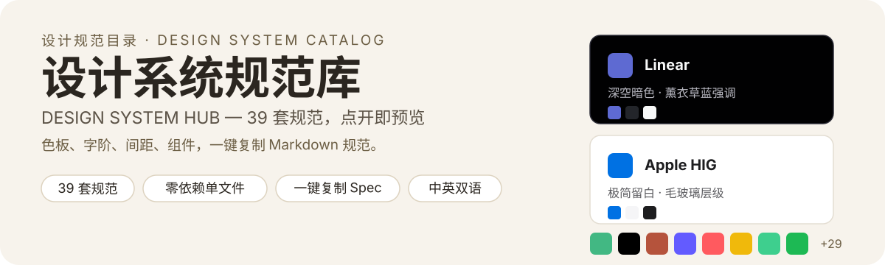
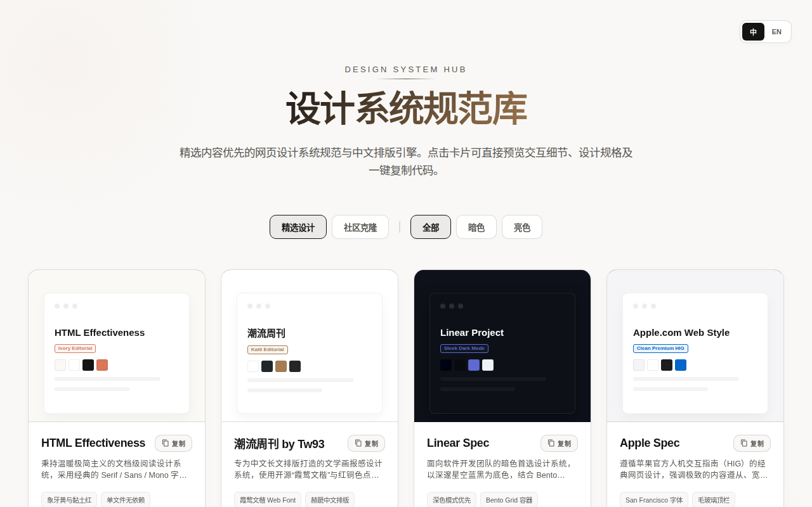
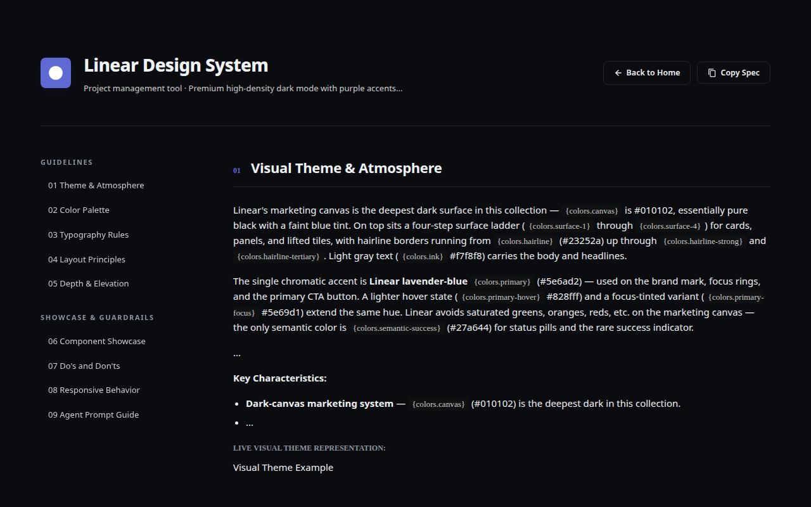

<p align="right"><a href="README.md">中文</a></p>

<p align="center">
  
</p>

<p align="center">
  <a href="https://my-design-system.xiaosang.cc/">▶ Browse Online</a>
  ·
  <a href="https://holynova.github.io/my-design-system/">GitHub Pages Mirror</a>
  ·
  <a href="https://github.com/holynova/my-design-system">GitHub Repository</a>
</p>

Design System Hub catalogs 39 web design system specs. Each one is a self-contained single-file HTML page you can preview (palette, type scale, spacing, components, do's and don'ts) plus a matching Markdown spec. Like one? Hit "Copy Spec" and paste the full spec into your project — or hand it to an AI to build pages by the book.

## Screenshots

<p align="center">
  
  
</p>

## All 39 Specs

| Category | Specs |
|------|------|
| Brands & Products | Apple, Nike, Tesla, BMW, Lamborghini, PlayStation, Nintendo 2001, Dell 1996, Airbnb, Spotify, Shopify, Binance, Coinbase |
| Dev Tools & SaaS | Linear, Notion, Figma, Framer, Vercel, Supabase, PostHog, Stripe, Tailwind CSS, Vue, Expo, Cal, Airtable, ClickHouse, Cursor, Claude, Mistral.ai, Cohere |
| Chinese Typography & Editorial | HTML Effectiveness, 潮流周刊 by Tw93 (Trends Weekly), Detail Design, UI Compare, Codex Resets, Project Brain, holynova-portfolio, Yadong Xie Lab |

Each spec has a same-named HTML detail page in `pages/` and a same-named Markdown spec in `specs/`.

## Features

- **Self-contained, zero dependencies**: every detail page is a standalone single file with all styles and scripts inline — no build step, works offline.
- **One-click copy**: the "Copy Spec" button in the top-right of each detail page copies the full Markdown spec (design principles + tokens) to the clipboard, with success feedback.
- **Catalog filters**: the homepage filters by 「精选设计 / 社区克隆」 ("Curated / Community clones") and 「全部 / 暗色 / 亮色」 ("All / Dark / Light"), with a Chinese/English UI toggle.
- **Native back navigation**: a back button in the top-right of each sub-page, styled to match that design system, returns to the catalog homepage in one click.
- **Dark mode**: specs like 潮流周刊 (Trends Weekly) and Linear support system-level dark mode.

## How to Use a Spec in Your Project

1. Open any spec detail page, click **Copy Spec** in the top-right, and save the Markdown spec into your project (e.g. `docs/design-system.md`).
2. Declare its tokens as CSS variables in your global styles — e.g. Vue's emerald green `--color-brand: #42b883`.
3. With frameworks like Tailwind, extend the tokens into your config (e.g. `theme.extend.colors.brand`), then use utility classes like `bg-brand`.

## Run Locally

Zero build — just open `index.html` to browse, or start a static server:

```bash
python3 -m http.server 8000
# Open http://localhost:8000
```

## Tech

- Plain HTML + CSS + a little JS, zero dependencies, zero build; each of the 39 detail pages is a self-contained file.
- Spec text lives as Markdown in `specs/`; detail pages use `pages/page-actions.js` for copy and back actions.

```
index.html          Catalog homepage: card grid, filters, Chinese/English toggle
pages/              39 spec detail pages (HTML, self-contained)
specs/              39 spec originals (Markdown)
screenshot.png      Legacy preview screenshot (kept)
```
