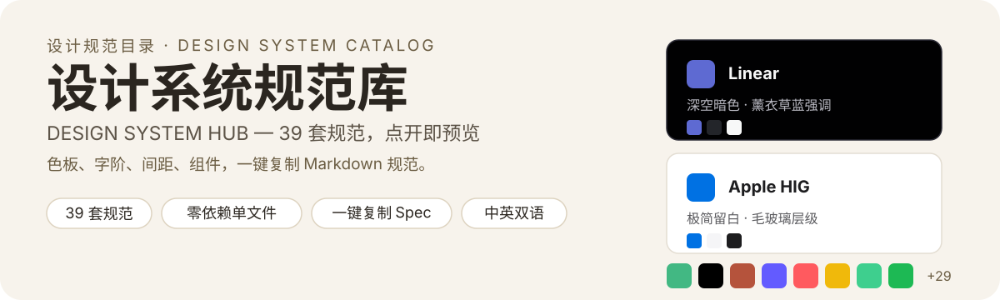
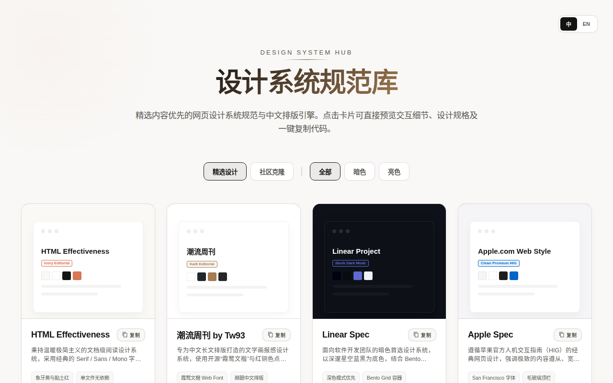
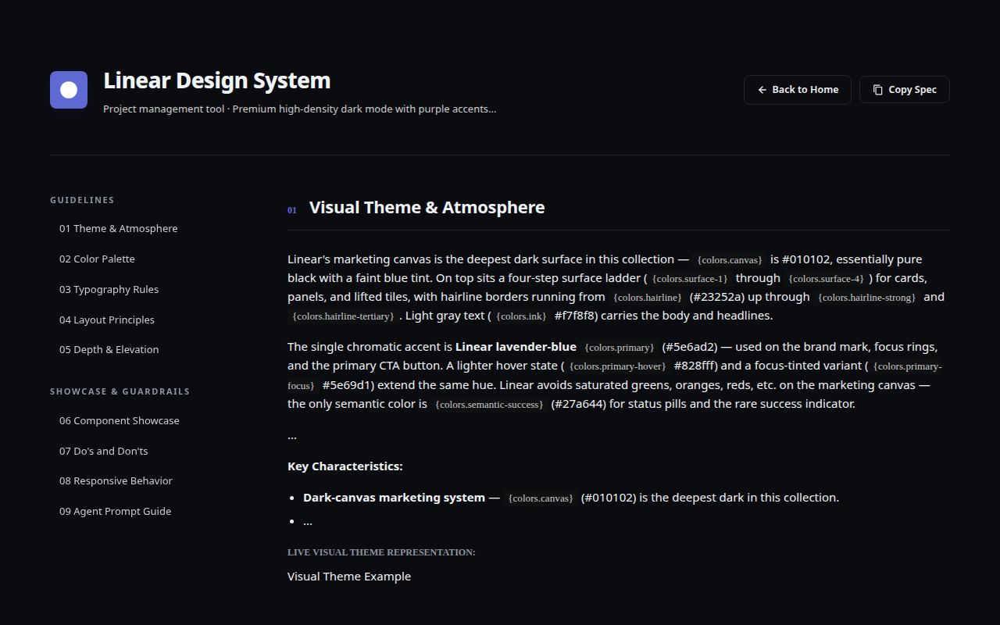

<p align="right"><a href="README.en.md">English</a></p>

<p align="center">
  
</p>

<p align="center">
  <a href="https://my-design-system.xiaosang.cc/">▶ 在线浏览</a>
  ·
  <a href="https://holynova.github.io/my-design-system/">GitHub Pages 镜像</a>
  ·
  <a href="https://github.com/holynova/my-design-system">GitHub 仓库</a>
</p>

设计系统规范库收录 39 套网页设计规范：每套都是一份可直接预览的单文件 HTML 详情页（色板、字阶、间距、组件、Do's and Don'ts），外加一份同名 Markdown 规范文本。看中哪套，点「Copy Spec」就能把完整规范复制走，贴进自己的项目或交给 AI 按规范写页面。

## 截图

<p align="center">
  
  
</p>

## 收录的 39 套规范

| 类别 | 规范 |
|------|------|
| 品牌与产品 | Apple、Nike、Tesla、BMW、Lamborghini、PlayStation、Nintendo 2001、Dell 1996、Airbnb、Spotify、Shopify、Binance、Coinbase |
| 开发者工具与 SaaS | Linear、Notion、Figma、Framer、Vercel、Supabase、PostHog、Stripe、Tailwind CSS、Vue、Expo、Cal、Airtable、ClickHouse、Cursor、Claude、Mistral.ai、Cohere |
| 中文排版与编辑 | HTML Effectiveness、潮流周刊 by Tw93、Detail Design、UI Compare、Codex Resets、Project Brain、holynova-portfolio、Yadong Xie Lab |

每套规范在 `pages/` 有同名 HTML 详情页，在 `specs/` 有同名 Markdown 规范原文。

## 功能

- **自包含、零依赖**：每个详情页都是独立单文件，样式与脚本全在文件内，无需构建、离线可看。
- **一键复制规范**：详情页右上角「Copy Spec」按钮，把整份 Markdown 规范（含设计原则与 token）复制到剪贴板，带成功反馈。
- **目录筛选**：主页按「精选设计 / 社区克隆」与「全部 / 暗色 / 亮色」筛选，支持中/英文界面切换。
- **原生返回导航**：子页面右上角返回按钮，风格与该设计系统一致，一键回目录主页。
- **暗色模式**：潮流周刊、Linear 等规范支持系统级暗色模式。

## 在项目里用这些规范

1. 打开任意规范详情页，点右上角 **Copy Spec**，把 Markdown 规范存到项目里（如 `docs/design-system.md`）。
2. 按规范里的 token 在全局样式中声明 CSS 变量，例如 Vue 翡翠绿 `--color-brand: #42b883`。
3. 用 Tailwind 等框架时，把 token 扩展进配置文件（如 `theme.extend.colors.brand`），之后直接用 `bg-brand` 这类原子类。

## 本地运行

零构建，直接打开 `index.html` 即可浏览；或起一个静态服务器：

```bash
python3 -m http.server 8000
# 打开 http://localhost:8000
```

## 技术

- 纯 HTML + CSS + 少量 JS，零依赖、零构建；39 个详情页各为一个自包含文件。
- 规范文本以 Markdown 存放在 `specs/`，详情页通过 `pages/page-actions.js` 实现复制与返回。

```
index.html          目录主页：卡片网格、筛选、中英切换
pages/              39 个规范详情页（HTML，自包含）
specs/              39 份规范原文（Markdown）
screenshot.png      旧版预览截图（保留）
```
